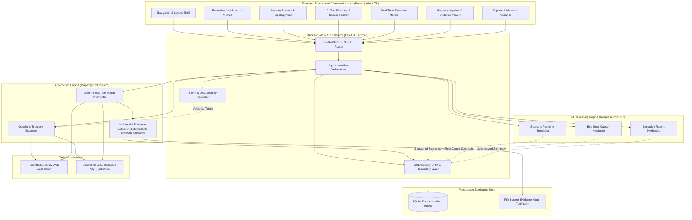
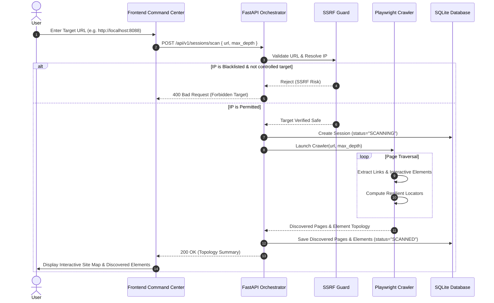
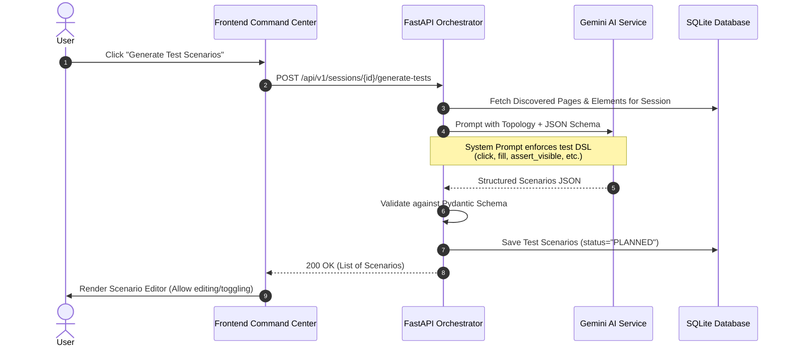
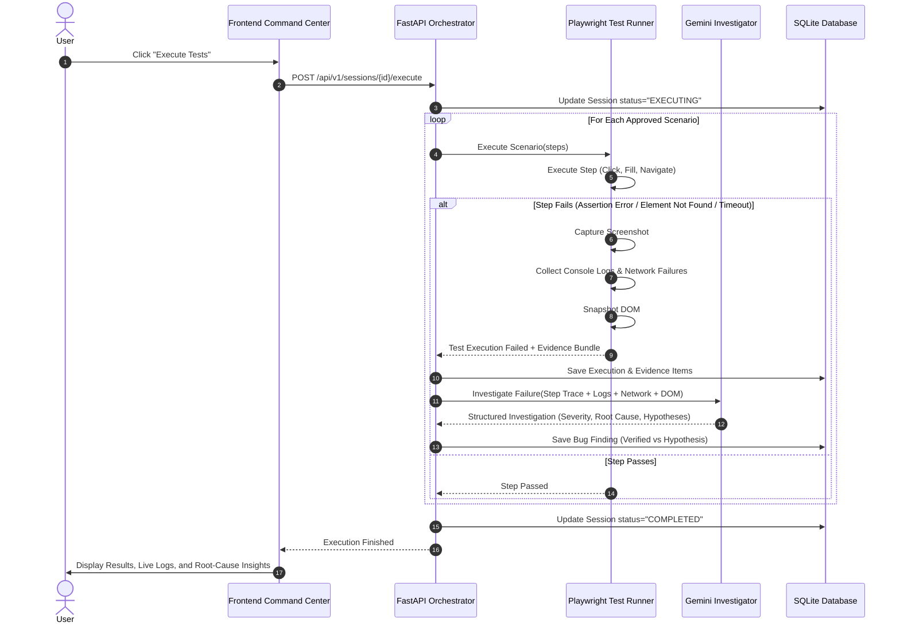

# ARCHITECTURE DESIGN: Autonomous Software Testing & Bug Investigation Agent

## 1. System Overview

The **Autonomous Software Testing & Bug Investigation Agent** is structured as a decoupled, multi-tier system combining modern reactive frontend interfaces with a high-performance Python ASGI backend, asynchronous browser automation workers, and cloud generative AI models.



---

## 2. Component Breakdown

### 2.1 Frontend AI Command Center
- **Framework**: React 19 with TypeScript and Vite.
- **Styling**: Tailwind CSS with custom design tokens for the "Futuristic Command Center" aesthetic (dark slate backgrounds `#0A0E17`, glassmorphism panels, electric blue `#00E5FF` and violet `#7C3AED` accent glows, monospace data readouts).
- **Icons**: Lucide React (clean, geometric, no emojis).
- **Data Visualizations**: Recharts for pass/fail donut charts, execution latency timelines, bug severity distributions, and trend analytics.
- **State Management**: React Query / SWR-like custom hooks for real-time polling or Server-Sent Events (SSE) streaming of active scan/execution updates.
- **View Hierarchy**:
  - `DashboardView`: Key platform metrics, quick start URL scanner, recent session cards.
  - `ScannerView`: URL target input, security validation indicator, crawl depth control, interactive DOM topology graph.
  - `PlanningView`: Discovered scenarios, editable steps, test case toggle, "Generate with Gemini" trigger.
  - `ExecutionView`: Live execution stream, step-by-step progress, pass/fail status pills, real-time log terminal.
  - `InvestigationView`: Deep failure breakdown, split-screen verified evidence vs. AI hypotheses, DOM tree inspector, screenshot zoom viewer.
  - `ReportsView`: Session history table, comprehensive Markdown/HTML export, trend analysis charts.

### 2.2 Backend API & Orchestration Engine
- **Framework**: FastAPI (asynchronous Python 3.12+).
- **Validation**: Pydantic v2 schemas for all request payloads, database models, and Gemini structured outputs.
- **Orchestration**: Asynchronous state machine managing the testing session lifecycle:
  `DRAFT` -> `SCANNING` -> `SCANNED` -> `PLANNING` -> `PLANNED` -> `EXECUTING` -> `INVESTIGATING` -> `COMPLETED` / `FAILED`.
- **SSRF Protection Subsystem**:
  1. URL syntax validation and normalization.
  2. Asynchronous DNS resolution via `dnspython` or `socket.getaddrinfo`.
  3. Strict IP address filtering against private, multicast, carrier-grade NAT, and cloud metadata blocks (e.g. AWS `169.254.169.254`).
  4. Controlled local testing bypass: strictly allows `http://localhost:8088` or `http://127.0.0.1:8088` only when the target is explicitly flagged as the internal test app.

### 2.3 Browser Automation & Evidence Engine (Playwright)
- **Engine**: Headless Chromium via Python Playwright (`async_playwright`).
- **Crawler & Surface Mapper**:
  - Traverses internal links up to configured depth limit.
  - Extracts interactive elements (`button`, `input`, `a`, `select`, `textarea`, ARIA `role="button"`).
  - Identifies forms and their child inputs, labels, and submit triggers.
  - Computes resilient locators (semantic ARIA role/label > ID > unique CSS).
- **Deterministic Action Interpreter**:
  - Reads test step JSON schemas and maps them to deterministic Playwright calls:
    - `navigate(url)` -> `page.goto(url, wait_until="networkidle")`
    - `click(selector)` -> `page.locator(selector).click()`
    - `fill(selector, value)` -> `page.locator(selector).fill(value)`
    - `select(selector, value)` -> `page.locator(selector).select_option(value)`
    - `assert_visible(selector)` -> `expect(page.locator(selector)).to_be_visible()`
    - `assert_text(selector, expected)` -> `expect(page.locator(selector)).to_contain_text(expected)`
  - **Zero Arbitrary Execution**: Never invokes `eval()` or runs unstructured script strings.
- **Evidence Collector**:
  - Intercepts all `page.on("console")` events and catalogs messages by level (`error`, `warning`, `info`).
  - Intercepts all `page.on("response")` events, capturing HTTP status `>= 400` with request URL and headers.
  - On failure, captures full viewport screenshot (`.png`) and DOM snapshot (`.html`).

### 2.4 AI Intelligence & Reasoning Subsystem (Gemini)
- **Model**: `gemini-2.5-flash` (or `gemini-1.5-pro` configurable via environment).
- **Format Enforcement**: Gemini API called with `response_mime_type="application/json"` and Pydantic response schemas.
- **Specialized Tasks**:
  1. **Test Scenario Generation**: Ingests discovered elements and synthesizes positive, negative, and edge-case journeys.
  2. **Bug Investigation**: Ingests step failure details, exception traceback, browser console errors, failed network responses, and DOM context. Synthesizes bug summary, severity score, probable root causes, and recommended fixes.
  3. **Evidence Grounding**: The system forces a strict two-part output:
     - `verified_evidence`: Objective facts proven by the execution trace.
     - `ai_hypotheses`: Plausible underlying reasons generated by LLM reasoning.
  4. **Executive Reporting**: Generates high-level summaries and release stability recommendations.

### 2.5 Database & Storage Architecture
- **ORM**: SQLAlchemy 2.0 with asynchronous session support (`async_sessionmaker`).
- **Database Engine**: SQLite with Write-Ahead Logging (`PRAGMA journal_mode=WAL;`), ensuring concurrent reads and writes without database lock contention.
- **Portability**: Schema adheres to standard ANSI SQL types, enabling seamless transition to PostgreSQL via changing `DATABASE_URL`.
- **Artifacts Vault**: Local directory (`artifacts/<session_id>/`) storing screenshots, DOM snapshots, network traces, and exported reports.

---

## 3. Data Flow & Sequence Diagrams

### 3.1 Website Scanning & Topology Mapping Flow


### 3.2 AI Test Planning Flow


### 3.3 Test Execution & Bug Investigation Flow


---

## 4. Complete Proposed Folder Structure

```
d:\Projects\Autonomous Software Testing & Bug Investigation Agent\
├── .agents/
│   └── rules/
│       └── rule.md                     # Core project rules & instructions
├── .env.example                        # Template environment variables
├── .gitignore                          # Ignored artifacts, virtual environments, node_modules
├── README.md                           # Main developer onboarding and setup documentation
├── PROJECT_PLAN.md                     # Roadmap, scope, milestones, risks
├── REQUIREMENTS.md                     # Functional & non-functional requirements
├── ARCHITECTURE.md                     # System architecture & component design
├── TASK_TRACKER.md                     # Phase-by-phase implementation tracker
├── TECHNICAL_DOCUMENTATION.md          # Database schema, API spec, and engine DSL
├── TESTING_REPORT.md                   # Environment audit and testing verification logs
├── CHANGELOG.md                        # Versioning and modification history
│
├── backend/                            # Python FastAPI Backend
│   ├── app/
│   │   ├── __init__.py
│   │   ├── main.py                     # ASGI application entrypoint & middleware
│   │   ├── config.py                   # Pydantic BaseSettings environment config
│   │   ├── database.py                 # SQLAlchemy engine, session maker, base model
│   │   ├── api/                        # REST API routing layer
│   │   │   ├── __init__.py
│   │   │   ├── v1/
│   │   │   │   ├── __init__.py
│   │   │   │   ├── router.py           # Unified v1 router
│   │   │   │   ├── projects.py         # Project management endpoints
│   │   │   │   ├── sessions.py         # Test session lifecycle endpoints
│   │   │   │   ├── scanner.py          # Crawler & element discovery endpoints
│   │   │   │   ├── generator.py        # AI test planning endpoints
│   │   │   │   ├── execution.py        # Test execution & telemetry endpoints
│   │   │   │   ├── investigation.py    # Bug diagnosis endpoints
│   │   │   │   └── reports.py          # Report generation & export endpoints
│   │   ├── models/                     # SQLAlchemy ORM database models
│   │   │   ├── __init__.py
│   │   │   ├── project.py              # Project entity
│   │   │   ├── session.py              # TestSession entity
│   │   │   ├── page.py                 # DiscoveredPage entity
│   │   │   ├── element.py              # DiscoveredElement entity
│   │   │   ├── scenario.py             # TestScenario entity
│   │   │   ├── execution.py            # TestExecution & StepResult entities
│   │   │   ├── bug.py                  # BugFinding entity
│   │   │   ├── evidence.py             # EvidenceItem entity
│   │   │   └── report.py               # Report entity
│   │   ├── schemas/                    # Pydantic request/response schemas
│   │   │   ├── __init__.py
│   │   │   ├── common.py
│   │   │   ├── project.py
│   │   │   ├── session.py
│   │   │   ├── topology.py
│   │   │   ├── test_dsl.py             # Action & assertion DSL schemas
│   │   │   ├── execution.py
│   │   │   ├── investigation.py        # AI investigation schemas
│   │   │   └── report.py
│   │   ├── services/                   # Core business logic & orchestration
│   │   │   ├── __init__.py
│   │   │   ├── orchestrator.py         # State machine workflow manager
│   │   │   ├── ssrf_validator.py       # Security & IP blacklist validator
│   │   │   ├── crawler.py              # Playwright site explorer
│   │   │   ├── test_runner.py          # Deterministic Playwright test runner
│   │   │   ├── evidence_collector.py   # Screenshots, logs, network recorder
│   │   │   ├── gemini_client.py        # Gemini API client & prompt manager
│   │   │   ├── bug_investigator.py     # Root-cause analysis engine
│   │   │   └── report_generator.py     # Report compiler (MD/HTML/JSON)
│   │   └── utils/
│   │       ├── __init__.py
│   │       └── logger.py               # Structured logger
│   ├── tests/                          # Backend Pytest test suite
│   │   ├── conftest.py
│   │   ├── test_ssrf.py                # Security SSRF tests
│   │   ├── test_api_projects.py        # Project CRUD tests
│   │   ├── test_api_sessions.py        # Session lifecycle tests
│   │   ├── test_crawler.py             # Playwright crawler tests
│   │   ├── test_runner_dsl.py          # Deterministic DSL execution tests
│   │   └── test_investigator.py        # Gemini failure diagnosis tests
│   ├── pyproject.toml                  # Python package & dependency metadata
│   └── requirements.txt                # Pinned backend dependencies
│
├── frontend/                           # React + Vite + TypeScript Frontend
│   ├── index.html                      # Single page entry HTML
│   ├── package.json                    # Node dependencies & scripts
│   ├── tsconfig.json                   # TypeScript configuration
│   ├── vite.config.ts                  # Vite build & proxy configuration
│   ├── tailwind.config.js              # Command Center dark palette & typography
│   ├── postcss.config.js
│   ├── src/
│   │   ├── main.tsx                    # React application root
│   │   ├── App.tsx                     # Top-level router & layout shell
│   │   ├── index.css                   # Global styles & design tokens
│   │   ├── assets/                     # Static graphical assets
│   │   ├── components/                 # Reusable UI components
│   │   │   ├── layout/                 # Sidebar, Topbar, StatusFooter
│   │   │   ├── common/                 # Buttons, Badges, Modals, Cards, Loaders
│   │   │   ├── charts/                 # Recharts metric widgets
│   │   │   └── evidence/               # Screenshot zoom viewer, Log terminal, DOM diff
│   │   ├── views/                      # Primary application views
│   │   │   ├── DashboardView.tsx       # Platform overview & metrics
│   │   │   ├── ScannerView.tsx         # Target onboarding & crawler topology
│   │   │   ├── PlanningView.tsx        # AI scenario editor & generator
│   │   │   ├── ExecutionView.tsx       # Live runner & real-time telemetry
│   │   │   ├── InvestigationView.tsx   # Root-cause diagnosis & evidence split
│   │   │   └── ReportsView.tsx         # Session history & report exports
│   │   ├── services/                   # API client integrations
│   │   │   ├── api.ts                  # Axios/fetch base client
│   │   │   ├── projectsApi.ts
│   │   │   ├── sessionsApi.ts
│   │   │   └── reportsApi.ts
│   │   ├── types/                      # TypeScript domain interfaces
│   │   │   └── index.ts
│   │   └── hooks/                      # Custom React hooks (polling, status)
│   │       └── useSessionStream.ts
│   └── tests/                          # Frontend Vitest / Testing Library tests
│
├── controlled_test_app/                # Local Intentionally Defective Web Application
│   ├── app.py                          # Lightweight FastAPI or Flask test target
│   ├── templates/                      # Interactive HTML pages
│   │   ├── index.html                  # Landing page with navigation
│   │   ├── login.html                  # Auth page
│   │   ├── checkout.html               # Form with validation bugs
│   │   └── modal_bug.html              # Interactive modal with DOM disappearance glitch
│   └── static/                         # Assets & scripts triggering JS errors
│
└── artifacts/                          # File storage for screenshots, logs, and reports
    └── .gitkeep
```

---

## 5. Security & Isolation Architecture

### 5.1 SSRF Defense-in-Depth Pipeline
Any user-supplied URL undergoes a 4-tier security validation before a browser process is spawned:
1. **Scheme Validation**: Only `http://` and `https://` protocols are allowed. File (`file://`), FTP, gopher, and internal schemes are immediately rejected.
2. **DNS Pre-Flight Resolution**: Hostname is resolved to IP addresses via asynchronous DNS lookup.
3. **CIDR Deny-List Check**: The resolved IP is tested against:
   - `127.0.0.0/8` (Loopback)
   - `10.0.0.0/8` (Private)
   - `172.16.0.0/12` (Private)
   - `192.168.0.0/16` (Private)
   - `169.254.169.254/32` (AWS/GCP/Azure link-local metadata)
   - `::1` and `fc00::/7` (IPv6 loopback and unique local)
   - *Exception*: Local testing of the controlled target is permitted ONLY when the hostname is explicitly `localhost:8088` and the request carries an internal verification flag.
4. **Navigation Redirect Monitoring**: In Playwright, `page.on("request")` verifies that any HTTP redirect does not navigate to a forbidden IP address.

### 5.2 Deterministic Execution Isolation
- Test scenarios are represented solely as structured JSON DSL.
- The execution engine implements a strict dispatcher matching exact action keys (`click`, `fill`, `press`, `navigate`, `assert_visible`).
- **No string evaluation (`eval()`)**, dynamic script injection, or shell invocation occurs during test execution.
- Browser contexts are ephemeral: cookies, cache, and local storage are purged between test scenarios to guarantee independence.

### 5.3 Secrets & Environment Hygiene
- The `GEMINI_API_KEY` is loaded exclusively through `pydantic-settings` from a protected `.env` file on the server.
- The frontend client never receives or stores the API key.
- API error handlers sanitize stack traces and scrub authentication tokens prior to returning responses to the client.
