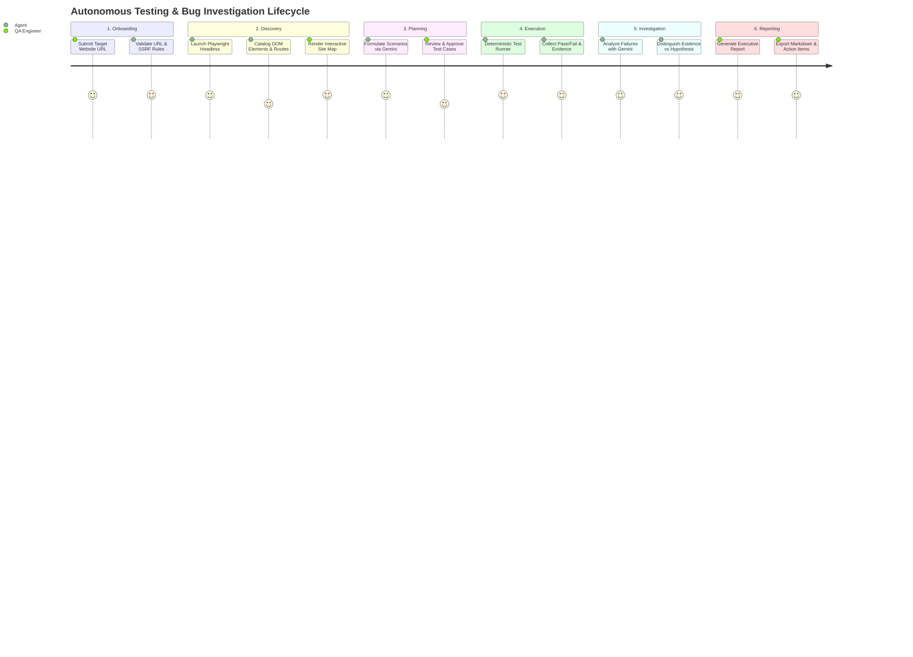

# REQUIREMENTS SPECIFICATION: Autonomous Software Testing & Bug Investigation Agent

## 1. Overview & System Purpose

The **Autonomous Software Testing & Bug Investigation Agent** is designed to provide autonomous, end-to-end quality assurance and defect diagnosis for modern web applications. The platform replaces fragile script-based testing and manual QA exploration with an intelligent agentic loop: discovering interactive application surfaces, generating context-aware test cases, executing tests in an isolated browser sandbox, capturing multimodal diagnostic evidence upon failure, and using LLM reasoning to pinpoint potential root causes.

---

## 2. Functional Requirements (FR)

### FR1: Target URL Validation & Secure Onboarding
- **FR1.1**: The system shall accept a target website URL via the user interface or API.
- **FR1.2**: The system shall validate URL syntax (scheme `http` or `https` only) and reject malformed inputs.
- **FR1.3**: The system shall perform pre-flight DNS resolution to identify target IP addresses.
- **FR1.4**: The system shall enforce SSRF protection by disallowing access to private IP ranges (`10.0.0.0/8`, `172.16.0.0/12`, `192.168.0.0/16`, `127.0.0.0/8`, `169.254.169.254`, `::1`, `fc00::/7`), cloud metadata services, and internal ports, except when an explicit controlled local testing flag is activated.
- **FR1.5**: The system shall enforce an exploration depth limit (default: 3 levels) and maximum page count (default: 15 pages) to prevent runaway crawling.

### FR2: Autonomous Crawler & DOM Explorer
- **FR2.1**: The system shall launch a headless Chromium instance via Playwright to explore the target URL.
- **FR2.2**: The crawler shall discover all reachable same-origin links, ignoring external third-party redirects.
- **FR2.3**: The DOM inspection engine shall catalog interactive elements, including:
  - Buttons (`<button>`, `role="button"`, submit inputs)
  - Text input fields (`<input type="text|email|password|number|search">`, `<textarea>`)
  - Dropdowns (`<select>`, custom ARIA comboboxes)
  - Checkboxes and radio buttons
  - Modals, dialogues, and accordions
- **FR2.4**: The system shall compute unique, robust CSS selectors and Playwright-compatible locators (preferring semantic locators: `getByRole`, `getByLabel`, `getByPlaceholder`, `getByTestId`).
- **FR2.5**: The system shall construct a site navigation graph detailing discovered pages, navigation routes, and interactive components.

### FR3: AI Test Scenario Planning (Gemini)
- **FR3.1**: The system shall feed the discovered page topology, forms, and interaction surfaces to the Gemini API.
- **FR3.2**: The system shall request structured test scenarios covering:
  - Happy path user journeys (e.g., successful login, valid form submission, search execution).
  - Negative validation testing (e.g., empty required fields, invalid email format, boundary values).
  - UI responsiveness and interaction edge cases (e.g., clicking disabled buttons, rapid clicking, modal dismissal).
- **FR3.3**: The AI output shall strictly adhere to a Pydantic schema containing:
  - `scenario_id`: Unique identifier.
  - `title`: Short descriptive name.
  - `description`: Test objective and business rationale.
  - `page_url`: Target URL path.
  - `steps`: Ordered list of discrete actions (`action`: click|fill|select|press|hover|navigate, `selector`: locator string, `value`: input text if applicable, `expected`: condition to assert).
  - `expected_result`: High-level business expectation.
- **FR3.4**: The system shall reject and reprompt or filter duplicate, vague, or non-executable test scenarios.
- **FR3.5**: The system shall allow the user to review, edit, approve, or toggle individual test scenarios before execution.

### FR4: Deterministic Playwright Test Execution
- **FR4.1**: The system shall execute approved scenarios sequentially or in controlled parallel batches using isolated browser contexts.
- **FR4.2**: The execution engine shall interpret actions deterministically without evaluating arbitrary code or scripts.
- **FR4.3**: The engine shall apply configurable step timeouts (default: 5000ms) and global scenario timeouts (default: 30000ms).
- **FR4.4**: The engine shall evaluate assertions deterministically:
  - Element visibility (`toBeVisible()`)
  - Text content match (`toHaveText()`, `toContainText()`)
  - URL change (`toHaveURL()`)
  - Input values (`toHaveValue()`)
- **FR4.5**: The system shall mark a test case as `PASSED`, `FAILED`, `TIMED_OUT`, or `SKIPPED`.

### FR5: Multimodal Diagnostic Evidence Capture
- **FR5.1**: For every test step, the engine shall record start time, duration, and execution outcome.
- **FR5.2**: Upon test failure, the engine shall immediately capture:
  - Full-page viewport screenshot.
  - Element-specific screenshot of the failing component if locatable.
  - Browser console logs (errors, warnings, unhandled promise rejections).
  - Network logs (failed HTTP status codes `>= 400`, pending requests, CORS failures).
  - Page DOM snapshot at the time of failure.
- **FR5.3**: All evidence artifacts shall be persisted to disk under a dedicated session directory and referenced by URI in the database.

### FR6: AI Bug Investigation & Root Cause Analysis
- **FR6.1**: For every failed test execution, the system shall assemble a diagnostic payload:
  - Test scenario definition and executed step trace.
  - Specific step failure reason and exception message.
  - Browser console logs and network response codes.
  - DOM snapshot snippet around the failing locator.
- **FR6.2**: The system shall pass the diagnostic payload to Gemini to analyze:
  - Likely bug category (`FUNCTIONAL_DEFECT`, `VALIDATION_ERROR`, `NETWORK_FAILURE`, `UI_ELEMENT_MISSING`, `PERFORMANCE_TIMEOUT`, `SCRIPT_EXCEPTION`).
  - Severity level (`CRITICAL`, `HIGH`, `MEDIUM`, `LOW`).
  - Potential root-cause hypotheses.
  - Recommended developer remediation steps.
- **FR6.3**: **Evidence Grounding Rule**: The system shall explicitly split investigation outputs into two unambiguous sections:
  - **Verified Evidence**: Factual findings verified by deterministic code (HTTP 500 status, JS error message, timeout, missing DOM node).
  - **AI Hypothesis**: Probable explanations generated by Gemini (e.g., backend database query timeout, broken API contract, state desynchronization).
- **FR6.4**: The system shall forbid presenting unconfirmed AI assumptions as verified facts.

### FR7: Executive & Technical Reporting
- **FR7.1**: The system shall compile a comprehensive report for each testing session.
- **FR7.2**: The report shall include an executive summary (total tests, pass rate, duration, bug severity breakdown).
- **FR7.3**: The report shall include detailed test breakdowns with embedded screenshot links, console logs, and step timelines.
- **FR7.4**: The report shall support export to Markdown, JSON, and printable HTML format.

### FR8: Historical Session Analytics & Dashboard
- **FR8.1**: The system shall persist all projects, sessions, tests, executions, bugs, and reports in the database.
- **FR8.2**: The frontend dashboard shall display high-level metrics (total scans, total tests executed, overall pass rate, critical bugs found).
- **FR8.3**: The dashboard shall provide interactive Recharts visualizations showing testing trends over time.
- **FR8.4**: Users shall be able to filter past sessions by target domain, status, date, or severity.

### FR9: Controlled Local Defective Test Website
- **FR9.1**: The system shall include an embedded, isolated local test web application specifically built to verify the autonomous testing agent.
- **FR9.2**: The test site shall feature:
  - A functional login flow.
  - A shopping cart / checkout flow with an intentional form validation bug (e.g., submits invalid payload, throws uncaught error).
  - An interactive modal with an intentional DOM disappearing glitch.
  - An API endpoint returning a 500 Internal Server Error under specific input.
  - A client-side JavaScript crash triggered by a specific button click.
- **FR9.3**: The local site shall serve as the ground-truth benchmark for testing the agent's full discovery, test generation, failure detection, and bug investigation cycle.

---

## 3. Non-Functional Requirements (NFR)

### NFR1: Security & Sandboxing
- **NFR1.1**: The system shall never execute arbitrary code generated by Gemini or downloaded from scanned websites.
- **NFR1.2**: Playwright browser contexts shall run with disabled permissions (geolocation, camera, microphone, notifications) and isolated cookies/local storage.
- **NFR1.3**: The backend shall strictly validate all incoming API payloads using Pydantic models.
- **NFR1.4**: Sensitive environment variables (e.g., `GEMINI_API_KEY`) shall never be exposed to the client or logged to disk.

### NFR2: Performance & Scalability
- **NFR2.1**: The backend API shall respond to non-execution status and CRUD queries within 100ms.
- **NFR2.2**: The crawler shall complete initial topological scanning of a 10-page application within 30 seconds.
- **NFR2.3**: SQLite database transactions shall use WAL (Write-Ahead Logging) mode to prevent concurrency locks during simultaneous execution and reporting.

### NFR3: Reliability & Fault Tolerance
- **NFR3.1**: If the Gemini API experiences rate limiting or timeouts, the system shall execute exponential backoff (1s, 2s, 4s) with a maximum of 3 retries before failing gracefully.
- **NFR3.2**: A crashed browser process shall not crash the FastAPI backend service; process termination shall be caught and recorded as an execution failure.
- **NFR3.3**: Corrupted or incomplete JSON returned by Gemini shall be repaired via schema validation fallbacks or gracefully flagged for regeneration.

### NFR4: Usability & UI/UX Standards
- **NFR4.1**: The UI shall strictly follow the "Futuristic AI Command Center" aesthetic (dark charcoal `#0B0F19`, slate navy `#111827`, electric cyan `#00F0FF`, violet `#8B5CF6`).
- **NFR4.2**: The UI shall use Lucide React icons exclusively; emojis are strictly prohibited in the user interface.
- **NFR4.3**: All charts, buttons, filters, and forms must be fully interactive and bound to real backend data.
- **NFR4.4**: Accessible contrast ratios (WCAG AA compliant) shall be maintained across all text and interactive controls.

### NFR5: Maintainability & Portability
- **NFR5.1**: Codebase shall maintain strict architectural separation between Presentation (React), API/Orchestration (FastAPI), Automation (Playwright), AI Reasoning (Gemini), and Persistence (SQLAlchemy).
- **NFR5.2**: The database layer shall use standard SQLAlchemy 2.0 ORM patterns compatible with both SQLite and PostgreSQL.

---

## 4. User Personas & Core Workflows

### 4.1 Target Personas
1. **QA Automation Engineer**: Needs autonomous test creation for rapidly changing web applications without maintaining brittle scripts manually.
2. **Software Developer / Tech Lead**: Needs instant regression testing and root-cause diagnostic evidence when deploying PRs or staging environments.
3. **Product Manager**: Needs executive-level health reports and risk scores indicating whether release candidates are stable.

### 4.2 Primary User Flow

