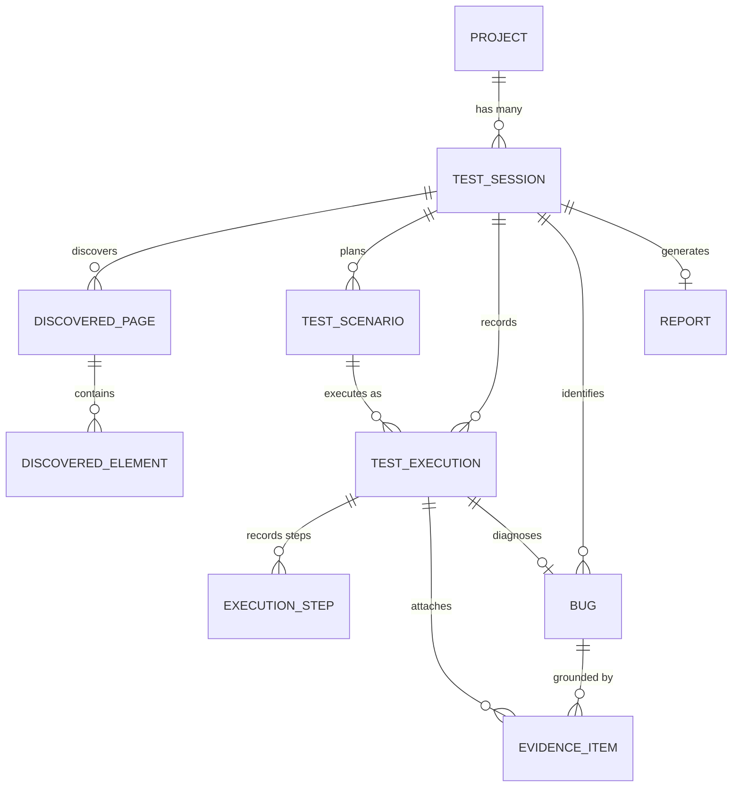

# TECHNICAL SPECIFICATION: Autonomous Software Testing & Bug Investigation Agent

## 1. Database Architecture & Relational Schema

The persistence layer uses **SQLAlchemy 2.0** with asynchronous connection pooling. The schema is designed for ANSI SQL compliance, providing native support for both **SQLite (WAL mode)** and **PostgreSQL**.

### 1.1 Entity-Relationship Diagram


### 1.2 Table Definitions

#### Table: `projects`
Stores high-level application targets configured by users.
```sql
CREATE TABLE projects (
    id VARCHAR(36) PRIMARY KEY,
    name VARCHAR(255) NOT NULL,
    target_url TEXT NOT NULL,
    description TEXT,
    created_at TIMESTAMP WITH TIME ZONE DEFAULT CURRENT_TIMESTAMP NOT NULL,
    updated_at TIMESTAMP WITH TIME ZONE DEFAULT CURRENT_TIMESTAMP NOT NULL
);
CREATE INDEX idx_projects_created_at ON projects(created_at);
```

#### Table: `test_sessions`
Represents an individual testing run or investigation cycle.
```sql
CREATE TABLE test_sessions (
    id VARCHAR(36) PRIMARY KEY,
    project_id VARCHAR(36) NOT NULL REFERENCES projects(id) ON DELETE CASCADE,
    target_url TEXT NOT NULL,
    status VARCHAR(50) NOT NULL, -- DRAFT, SCANNING, SCANNED, PLANNING, PLANNED, EXECUTING, INVESTIGATING, COMPLETED, FAILED
    max_depth INTEGER DEFAULT 2 NOT NULL,
    max_pages INTEGER DEFAULT 15 NOT NULL,
    total_tests INTEGER DEFAULT 0 NOT NULL,
    passed_tests INTEGER DEFAULT 0 NOT NULL,
    failed_tests INTEGER DEFAULT 0 NOT NULL,
    error_summary TEXT,
    started_at TIMESTAMP WITH TIME ZONE DEFAULT CURRENT_TIMESTAMP NOT NULL,
    completed_at TIMESTAMP WITH TIME ZONE
);
CREATE INDEX idx_sessions_project_id ON test_sessions(project_id);
CREATE INDEX idx_sessions_status ON test_sessions(status);
```

#### Table: `discovered_pages`
Stores pages mapped during the browser crawl.
```sql
CREATE TABLE discovered_pages (
    id VARCHAR(36) PRIMARY KEY,
    session_id VARCHAR(36) NOT NULL REFERENCES test_sessions(id) ON DELETE CASCADE,
    url TEXT NOT NULL,
    title VARCHAR(500),
    http_status INTEGER,
    depth INTEGER DEFAULT 0 NOT NULL,
    screenshot_path TEXT,
    discovered_at TIMESTAMP WITH TIME ZONE DEFAULT CURRENT_TIMESTAMP NOT NULL
);
CREATE INDEX idx_pages_session_id ON discovered_pages(session_id);
```

#### Table: `discovered_elements`
Catalog of interactive components extracted from page DOMs.
```sql
CREATE TABLE discovered_elements (
    id VARCHAR(36) PRIMARY KEY,
    page_id VARCHAR(36) NOT NULL REFERENCES discovered_pages(id) ON DELETE CASCADE,
    tag_name VARCHAR(50) NOT NULL,
    element_type VARCHAR(50), -- button, link, input_text, select, checkbox, modal
    selector TEXT NOT NULL,
    semantic_label VARCHAR(255),
    attributes_json JSON NOT NULL,
    is_interactive BOOLEAN DEFAULT TRUE NOT NULL,
    parent_form_id VARCHAR(36)
);
CREATE INDEX idx_elements_page_id ON discovered_elements(page_id);
```

#### Table: `test_scenarios`
Structured test scenarios generated by Gemini.
```sql
CREATE TABLE test_scenarios (
    id VARCHAR(36) PRIMARY KEY,
    session_id VARCHAR(36) NOT NULL REFERENCES test_sessions(id) ON DELETE CASCADE,
    title VARCHAR(255) NOT NULL,
    description TEXT NOT NULL,
    category VARCHAR(50) NOT NULL, -- POSITIVE, NEGATIVE, BOUNDARY, RESPONSIVENESS
    target_page_url TEXT NOT NULL,
    steps_json JSON NOT NULL,      -- Array of DSL actions
    expected_result TEXT NOT NULL,
    is_approved BOOLEAN DEFAULT TRUE NOT NULL,
    order_index INTEGER DEFAULT 0 NOT NULL
);
CREATE INDEX idx_scenarios_session_id ON test_scenarios(session_id);
```

#### Table: `test_executions`
Results of running a test scenario.
```sql
CREATE TABLE test_executions (
    id VARCHAR(36) PRIMARY KEY,
    scenario_id VARCHAR(36) NOT NULL REFERENCES test_scenarios(id) ON DELETE CASCADE,
    session_id VARCHAR(36) NOT NULL REFERENCES test_sessions(id) ON DELETE CASCADE,
    status VARCHAR(50) NOT NULL, -- PASSED, FAILED, TIMED_OUT, SKIPPED
    duration_ms INTEGER NOT NULL,
    error_message TEXT,
    error_step_index INTEGER,
    executed_at TIMESTAMP WITH TIME ZONE DEFAULT CURRENT_TIMESTAMP NOT NULL
);
CREATE INDEX idx_executions_scenario_id ON test_executions(scenario_id);
CREATE INDEX idx_executions_session_id ON test_executions(session_id);
```

#### Table: `execution_steps`
Individual step execution timeline and traces.
```sql
CREATE TABLE execution_steps (
    id VARCHAR(36) PRIMARY KEY,
    execution_id VARCHAR(36) NOT NULL REFERENCES test_executions(id) ON DELETE CASCADE,
    step_index INTEGER NOT NULL,
    action VARCHAR(50) NOT NULL,
    selector TEXT,
    value TEXT,
    status VARCHAR(50) NOT NULL, -- PASSED, FAILED
    duration_ms INTEGER NOT NULL,
    error_log TEXT,
    screenshot_path TEXT
);
CREATE INDEX idx_steps_execution_id ON execution_steps(execution_id);
```

#### Table: `bugs`
Diagnosed defects analyzed by the Gemini Bug Investigator.
```sql
CREATE TABLE bugs (
    id VARCHAR(36) PRIMARY KEY,
    execution_id VARCHAR(36) NOT NULL REFERENCES test_executions(id) ON DELETE CASCADE,
    session_id VARCHAR(36) NOT NULL REFERENCES test_sessions(id) ON DELETE CASCADE,
    title VARCHAR(255) NOT NULL,
    category VARCHAR(50) NOT NULL, -- FUNCTIONAL_DEFECT, VALIDATION_ERROR, NETWORK_FAILURE, UI_MISSING, CRASH
    severity VARCHAR(50) NOT NULL, -- CRITICAL, HIGH, MEDIUM, LOW
    verified_evidence_json JSON NOT NULL, -- Deterministic facts (HTTP errors, JS exceptions, missing DOM)
    ai_hypothesis_json JSON NOT NULL,     -- LLM reasoning regarding root causes
    remediation_advice TEXT,
    created_at TIMESTAMP WITH TIME ZONE DEFAULT CURRENT_TIMESTAMP NOT NULL
);
CREATE INDEX idx_bugs_session_id ON bugs(session_id);
CREATE INDEX idx_bugs_severity ON bugs(severity);
```

#### Table: `evidence_items`
Multimodal diagnostic files associated with executions and bugs.
```sql
CREATE TABLE evidence_items (
    id VARCHAR(36) PRIMARY KEY,
    execution_id VARCHAR(36) NOT NULL REFERENCES test_executions(id) ON DELETE CASCADE,
    bug_id VARCHAR(36) REFERENCES bugs(id) ON DELETE SET NULL,
    evidence_type VARCHAR(50) NOT NULL, -- SCREENSHOT, CONSOLE_LOG, NETWORK_FAILURE, DOM_SNAPSHOT
    file_path TEXT NOT NULL,
    metadata_json JSON NOT NULL,
    captured_at TIMESTAMP WITH TIME ZONE DEFAULT CURRENT_TIMESTAMP NOT NULL
);
CREATE INDEX idx_evidence_execution_id ON evidence_items(execution_id);
CREATE INDEX idx_evidence_bug_id ON evidence_items(bug_id);
```

#### Table: `reports`
Aggregated executive and technical reports for a session.
```sql
CREATE TABLE reports (
    id VARCHAR(36) PRIMARY KEY,
    session_id VARCHAR(36) NOT NULL UNIQUE REFERENCES test_sessions(id) ON DELETE CASCADE,
    summary_markdown TEXT NOT NULL,
    metrics_json JSON NOT NULL,
    file_path_html TEXT,
    file_path_json TEXT,
    generated_at TIMESTAMP WITH TIME ZONE DEFAULT CURRENT_TIMESTAMP NOT NULL
);
CREATE INDEX idx_reports_session_id ON reports(session_id);
```

---

## 2. REST API Specification

All backend endpoints are prefixed with `/api/v1` and return JSON payloads conforming to standard Pydantic models.

### 2.1 Project Endpoints
- `GET /api/v1/projects`: List all configured projects.
- `POST /api/v1/projects`: Create a new project `{ name, target_url, description }`.
- `GET /api/v1/projects/{id}`: Retrieve project details and recent session summaries.
- `DELETE /api/v1/projects/{id}`: Delete a project and cascade-delete its sessions.

### 2.2 Testing Session Endpoints
- `POST /api/v1/sessions`: Create a new testing session `{ project_id, target_url, max_depth, max_pages }`.
- `GET /api/v1/sessions/{id}`: Get session status, metrics, and progress.
- `GET /api/v1/sessions/{id}/stream`: Server-Sent Events (SSE) endpoint providing live scan/execution progress events.
- `GET /api/v1/sessions`: List past sessions with optional filtering (`project_id`, `status`, `limit`).

### 2.3 Crawler & Discovery Endpoints
- `POST /api/v1/sessions/{id}/scan`: Trigger autonomous crawling and DOM topology mapping.
- `GET /api/v1/sessions/{id}/pages`: Retrieve all discovered pages and their status.
- `GET /api/v1/sessions/{id}/elements`: Retrieve discovered interactive elements with selector locators.

### 2.4 AI Test Planning Endpoints
- `POST /api/v1/sessions/{id}/generate-scenarios`: Prompt Gemini to formulate test scenarios from discovered topology.
- `GET /api/v1/sessions/{id}/scenarios`: List generated scenarios.
- `PUT /api/v1/sessions/{id}/scenarios/{scenario_id}`: Update, approve, or toggle scenario steps.

### 2.5 Execution Endpoints
- `POST /api/v1/sessions/{id}/execute`: Launch deterministic Playwright test runner against approved scenarios.
- `POST /api/v1/sessions/{id}/abort`: Signal cancellation of in-flight execution.
- `GET /api/v1/sessions/{id}/executions`: Retrieve all test execution records with step details.

### 2.6 Bug Investigation & Evidence Endpoints
- `GET /api/v1/sessions/{id}/bugs`: Retrieve all diagnosed bugs with evidence vs hypothesis splits.
- `GET /api/v1/bugs/{id}`: Get comprehensive bug diagnostic file (screenshots, traces, recommendations).
- `GET /api/v1/evidence/{id}/download`: Stream raw artifact file (image, HTML snapshot, log file).

### 2.7 Report Endpoints
- `POST /api/v1/sessions/{id}/report`: Synthesize final executive report.
- `GET /api/v1/sessions/{id}/report`: Fetch compiled report in Markdown and structured JSON.
- `GET /api/v1/sessions/{id}/report/download`: Download standalone HTML or PDF report bundle.

---

## 3. Playwright Automation & Deterministic DSL

### 3.1 Test Action DSL Schema
Test steps are represented in strict JSON schemas without raw JavaScript code:
```json
{
  "step_index": 1,
  "action": "fill",
  "selector": "input[name='email']",
  "value": "user@example.com",
  "timeout_ms": 5000,
  "expected": {
    "type": "value_equals",
    "target": "user@example.com"
  }
}
```

### 3.2 Supported DSL Actions
1. `navigate`: `page.goto(url, wait_until="networkidle")`
2. `click`: `page.locator(selector).click(timeout=timeout_ms)`
3. `fill`: `page.locator(selector).fill(value, timeout=timeout_ms)`
4. `select`: `page.locator(selector).select_option(value)`
5. `check`: `page.locator(selector).check()`
6. `press`: `page.locator(selector).press(value)` (e.g. `Enter`, `Tab`)
7. `assert_visible`: `expect(page.locator(selector)).to_be_visible()`
8. `assert_hidden`: `expect(page.locator(selector)).to_be_hidden()`
9. `assert_text`: `expect(page.locator(selector)).to_contain_text(value)`
10. `assert_url`: `expect(page).to_have_url(value)`

### 3.3 Multimodal Evidence Capture Interceptors
Playwright contexts attach listener hooks prior to executing actions:
- **Console Listener**:
  ```python
  page.on("console", lambda msg: console_logs.append({
      "type": msg.type,
      "text": msg.text,
      "location": msg.location
  }))
  ```
- **Network Failure Listener**:
  ```python
  page.on("response", lambda resp: network_logs.append({
      "url": resp.url,
      "status": resp.status,
      "status_text": resp.status_text
  }) if resp.status >= 400 else None)
  ```
- **Failure Artifact Dumper**:
  Captures `screenshot_path = f"artifacts/{session_id}/failure_step_{index}.png"` and DOM snapshot HTML.

---

## 4. AI Reasoning Specification (Gemini)

### 4.1 Test Generation Prompt Contract
- **Role**: Senior QA Automation Architect.
- **Input**: List of discovered pages, interactive forms, button labels, and input field types.
- **Constraints**:
  - Produce exactly 5-10 actionable, high-value test scenarios.
  - Mix positive, negative, and edge cases.
  - Return ONLY valid JSON adhering to `TestScenarioListSchema`.
  - Use only supported DSL action names.

### 4.2 Bug Investigation Prompt Contract
- **Role**: Principal Debugging & Root Cause Diagnostic Specialist.
- **Input**:
  - Failing test scenario and executed step sequence.
  - Precise exception message and failing locator.
  - Browser console logs (`error` and `warn` levels).
  - Failed HTTP network requests.
  - Snippet of page DOM around target element.
- **Grounding Mandate**:
  - Output MUST separate **Verified Evidence** (facts directly observed in logs or DOM) from **AI Hypotheses** (inferred backend issues or design bugs).
  - Categorize severity based on real impact:
    - `CRITICAL`: System crash, blocking user checkout, data corruption.
    - `HIGH`: Primary workflow broken, unhandled 500 error.
    - `MEDIUM`: Validation error not showing friendly message, UI layout glitch.
    - `LOW`: Minor styling or cosmetic issue.
