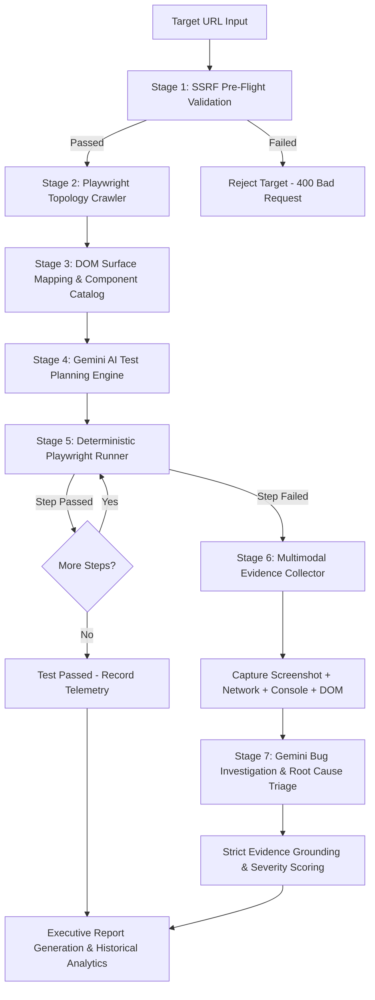
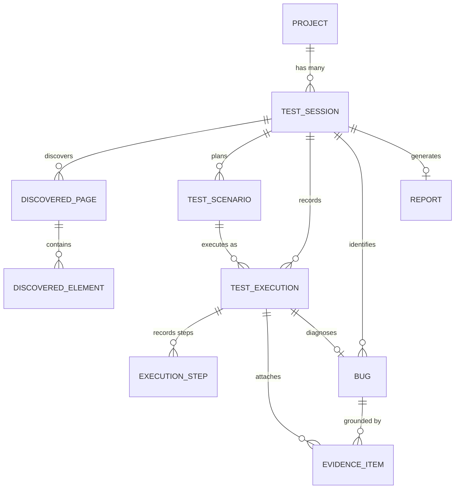

# AUTONOMOUS SOFTWARE TESTING & BUG INVESTIGATION AGENT
## Comprehensive Architecture, Operation & Technical Specification Report

---

## 1. Executive Summary

The **Autonomous Software Testing & Bug Investigation Agent** is an enterprise-grade, end-to-end quality engineering platform designed to eliminate the bottlenecks of modern software QA. By synthesizing **browser automation (Playwright Chromium)**, **generative reasoning (Google Gemini API)**, and a **deterministic execution engine**, the platform autonomously crawls web applications, maps their interactive topology, plans comprehensive test scenarios, executes deterministic test suites, captures multimodal failure evidence, investigates root causes, and delivers evidence-grounded bug reports.

Unlike fragile script-based frameworks or unconstrained "autonomous LLM agents" that hallucinate actions and execute unsafe code, this system implements a **dual-engine architecture**:
- **Generative AI** is strictly confined to high-level cognitive tasks: understanding UI structure, generating structured test scenarios, analyzing failure traces, and hypothesizing root causes.
- **Deterministic Code** handles all critical operations: browser navigation, input validation, pass/fail evaluation, database persistence, and security enforcement.

---

## 2. Problems We Are Solving (The QA Crisis)

Traditional software testing suffers from five critical structural flaws that slow down release cycles and let regressions slip into production:

### 2.1 The High Cost & Inefficiency of Manual Testing
- **The Problem**: Manual QA engineers spend hundreds of hours manually clicking buttons, filling out forms, checking responsive layouts, and verifying authentication flows. As application complexity grows exponentially with every sprint, human testing cannot scale.
- **The Impact**: QA becomes a bottleneck. Repetitive manual testing leads to cognitive fatigue, missed edge cases, and delayed deployment windows.

### 2.2 The Fragility and Flakiness of Legacy Automation (Selenium / Cypress)
- **The Problem**: Automated end-to-end testing typically requires engineers to write and maintain fragile test scripts using hard-coded CSS or XPath selectors (e.g. `div.container > form > input:nth-child(2)`).
- **The Impact**: A minor front-end refactoring (changing a class name, rearranging a layout, or updating Tailwind styles) breaks dozens of automated tests even when the underlying business logic works perfectly. Test maintenance costs often exceed initial development costs.

### 2.3 The "Blind Automation" Problem
- **The Problem**: Traditional test runners only report binary results: **PASS** or **FAIL**. When a test fails, the runner gives cryptic output like: `TimeoutError: element not found after 30000ms`.
- **The Impact**: Developers must manually reproduce the failure, inspect developer tools, re-run tests locally, check network tabs, and sift through server logs to find out *why* it failed.

### 2.4 The AI Hallucination & Execution Safety Dilemma
- **The Problem**: Attempting to solve this with generic LLM agents (e.g., auto-browsers running arbitrary code) introduces catastrophic risks:
  1. **Hallucination**: The AI claims a bug exists because it misinterpreted a feature or fabricated a state.
  2. **Security Vulnerabilities (SSRF)**: An AI agent instructed to "test the site" can be tricked into scanning internal company subnets (`192.168.x.x`), accessing cloud metadata services (`169.254.169.254`), or attacking local ports (`127.0.0.1:8000`).
  3. **Arbitrary Code Execution**: Letting an LLM generate arbitrary Python/Bash scripts to run on a machine introduces massive attack vectors.

### 2.5 Incomplete Evidence & Developer Friction
- **The Problem**: Bug reports submitted by QA or automated tools are often vague, lacking exact reproduction steps, console stack traces, network payloads, or viewport states at the millisecond of failure.
- **The Impact**: "Cannot Reproduce" tickets, wasted developer cycles, and prolonged defect resolution times.

---

## 3. The Proposed Solution: Dual-Engine Autonomous QA

The **Autonomous Software Testing & Bug Investigation Agent** resolves these fundamental problems through a structured, multi-tier architecture:

```
┌─────────────────────────────────────────────────────────────────────────────────┐
│                    AUTONOMOUS DUAL-ENGINE ARCHITECTURE                         │
├───────────────────────────────────────┬─────────────────────────────────────────┤
│       DETERMINISTIC ENGINE            │           COGNITIVE AI ENGINE           │
│   (Safety, Execution, Persistence)    │    (Reasoning, Planning, Diagnosis)     │
├───────────────────────────────────────┼─────────────────────────────────────────┤
│ • Pre-Flight SSRF Guard (CIDR Deny)   │ • Gemini AI Scenario Planner            │
│ • Playwright Chromium Headless Driver │ • Pydantic Schema JSON Enforcement      │
│ • Resilient Locator Engine (ARIA/Role)│ • Gemini Failure Root-Cause Engine      │
│ • Deterministic Action DSL Runner     │ • Strict Evidence vs. Hypothesis Split  │
│ • Multimodal Evidence Snapper         │ • Executive Report Synthesizer          │
│ • SQLite WAL / PostgreSQL DB Layer    │                                         │
└───────────────────────────────────────┴─────────────────────────────────────────┘
```

1. **No Manual Scripting Required**: The agent autonomously launches a headless browser, discovers pages, catalogs forms and buttons, and understands user journeys.
2. **Deterministic Action DSL**: The AI never generates executable code; it outputs a strictly validated **Action DSL** (Domain Specific Language) JSON schema (`navigate`, `click`, `fill`, `assert_visible`) executed deterministically by Playwright.
3. **Comprehensive Multimodal Evidence**: When a test fails, the agent automatically captures a full-page PNG screenshot, complete browser console error logs, failed HTTP network requests (status >= 400), and a DOM snapshot.
4. **Evidence Grounded Triage**: The AI diagnoses the failure and outputs a strict two-tier report:
   - **Verified Evidence**: Empirical facts proven by the execution trace (e.g. `POST /api/checkout returned HTTP 500`).
   - **AI Hypotheses**: Inferred underlying root causes (e.g. `Backend unhandled database constraint or missing price field`).
5. **Zero Hallucination Guardrail**: The agent never presents an AI hypothesis as a confirmed bug without verifiable execution evidence.
6. **Hardened SSRF Protection**: All input URLs are validated against DNS rebinding, private RFC-1918 subnets, loopback addresses, and cloud metadata IPs before the browser opens.

---

## 4. End-to-End Operational Lifecycle

The system operates across a 7-stage automated pipeline:



### Stage 1: Target Ingestion & SSRF Pre-Flight Check
The user submits a website URL (or clicks the controlled test app button). Before any browser is spawned, the `SSRFValidator` resolves the hostname to IPv4/IPv6 addresses, checks against blocked CIDR blocks (`127.0.0.0/8`, `10.0.0.0/8`, `172.16.0.0/12`, `192.168.0.0/16`, `169.254.169.254/32`), and denies prohibited protocols (`file://`, `gopher://`, `ftp://`).

### Stage 2: Autonomous DOM Surface Scanning & Topology Mapping
The `WebCrawlerService` initializes an isolated browser context in Playwright. It traverses the target website up to a configurable depth (default 2), extracts internal hyperlinks, and records page metadata (`url`, `title`, `http_status`, `depth`).

### Stage 3: Interactive Element Extraction & Resilient Locators
For every page visited, the scanner inspects the DOM and catalogs interactive elements:
- Buttons, inputs, forms, links, select dropdowns, checkboxes, and ARIA widgets.
- It computes a hierarchy of **Resilient Locators**: prioritizing semantic ARIA accessibility labels (`role="button"[name="Submit"]`), followed by unique HTML `id` attributes, and falling back to clean CSS selectors.

### Stage 4: AI Test Planning via Structured Gemini DSL
The `GeminiAIService` receives the catalog of discovered pages and elements. It synthesizes positive workflows (valid logins, form submissions), negative tests (invalid emails, empty fields), boundary conditions, and responsiveness journeys. The AI generates scenarios conforming to a strict JSON schema containing step-by-step DSL actions.

### Stage 5: Deterministic Playwright Execution
The `DeterministicTestRunner` executes each scenario in a fresh, isolated browser context. It interprets the DSL actions sequentially:
- `navigate`: Navigates to the page and waits for `networkidle`.
- `fill`: Clears and enters text into form inputs.
- `click`: Triggers mouse clicks with auto-scroll and visibility checks.
- `assert_visible`: Verifies UI elements render within timeout thresholds.
- `assert_text`: Verifies expected success banners or error feedback.

### Stage 6: Failure Detection & Multimodal Evidence Gathering
If an action fails (timeout, missing element, assertion mismatch), execution halts immediately. The runner captures:
- **High-Resolution PNG Screenshot**: The exact visual state of the viewport.
- **Browser Console Errors**: JavaScript exceptions, stack traces, and unhandled promise rejections.
- **HTTP Network Failures**: Failed API requests with HTTP status codes >= 400.
- **DOM Snapshot**: The raw HTML state at the moment of failure.

### Stage 7: Bug Investigation & Evidence Grounding
The `BugInvestigationService` feeds the execution trace, error traceback, console logs, network errors, and DOM snippet to Gemini. Gemini classifies the defect into a severity tier (`CRITICAL`, `HIGH`, `MEDIUM`, `LOW`), provides an executive summary, and strictly isolates verified evidence from AI hypotheses.

---

## 5. Detailed Feature Breakdown

### 5.1 Website Scanner & Topology Engine
- **Capabilities**:
  - Controlled crawling with configurable `max_depth` and `max_pages`.
  - DOM tree parsing that discovers buttons, links, inputs, and forms.
  - Generates interactive visual graph representations of site topology.
- **Inner Mechanics**:
  - Utilizes Playwright's `page.query_selector_all` and evaluated JavaScript expressions to extract interactive nodes while ignoring invisible/hidden elements (`display: none`, `visibility: hidden`).
  - Maps parent-child relationships between forms and input elements to understand structured data entry surfaces.

### 5.2 Gemini AI Test Planning Engine
- **Capabilities**:
  - Generates realistic test journeys based on actual discovered DOM elements.
  - Validates all AI outputs against Pydantic schemas using Gemini structured JSON mode (`response_mime_type="application/json"`).
  - Categorizes tests into `POSITIVE`, `NEGATIVE`, `BOUNDARY`, and `RESPONSIVENESS`.
- **Action DSL Specification**:
  ```json
  [
    { "action": "navigate", "target": "http://localhost:8088/login" },
    { "action": "fill", "target": "#username", "value": "testuser" },
    { "action": "fill", "target": "#password", "value": "validpass123" },
    { "action": "click", "target": "#login-btn" },
    { "action": "assert_visible", "target": "#dashboard-welcome" },
    { "action": "assert_text", "target": "#user-badge", "expected": "testuser" }
  ]
  ```

### 5.3 Deterministic Test Execution Sandbox
- **Capabilities**:
  - Zero arbitrary code execution: rejects arbitrary scripts, bash commands, or `eval()`.
  - Isolated browser sessions for each test scenario to prevent state leakage.
  - Deterministic timing controls: Playwright's auto-wait mechanisms ensure elements are ready before clicking or filling.

### 5.4 Multimodal Evidence Vault
- **Capabilities**:
  - Real-time event listeners on browser instances: `page.on("console")` and `page.on("response")`.
  - Timestamped disk persistence in `artifacts/<session_id>/` with relative path references stored in the database.
  - Interactive UI evidence viewer allowing full-screen image zoom, log filtering, and payload inspection.

### 5.5 Bug Investigation & Evidence Grounding Protocol
- **Capabilities**:
  - Severity classification engine (`CRITICAL`, `HIGH`, `MEDIUM`, `LOW`) based on business impact (e.g. Broken checkout = CRITICAL; Misaligned footer link = LOW).
  - **Grounding Protocol**:
    ```json
    {
      "verified_evidence": [
        "Form submission to /api/checkout returned HTTP 500 Internal Server Error",
        "Console logged: Uncaught (in promise) TypeError: Cannot read property 'id' of undefined",
        "DOM element #order-confirmation was never rendered within 5000ms"
      ],
      "ai_hypotheses": [
        "The checkout endpoint likely threw an unhandled exception when processing the cart item structure",
        "The frontend expected a JSON response containing an order id, but received an HTML 500 error page"
      ],
      "severity": "CRITICAL",
      "recommended_fix": "Add try-catch error handling to the /api/checkout route and validate cart payload before querying the database."
    }
    ```

### 5.6 Executive Analytics & Historical Reports
- **Capabilities**:
  - Recharts dynamic data visualizations: Pass/Fail ratio donut charts, Defect Severity distribution bar charts, and Execution Duration histograms.
  - Session history vault allowing users to review previous runs and track defect remediation over time.
  - Markdown and HTML executive report export.

### 5.7 Embedded Defect Benchmark Application (`controlled_test_app`)
- **Capabilities**:
  - Runs locally on port `8088` as a controlled test fixture.
  - Contains **5 deliberate defects**:
    1. **Authentication Defect**: Valid credentials occasionally trigger unexpected error feedback.
    2. **Checkout HTTP 500 Defect**: Submitting the checkout form triggers a simulated server-side crash.
    3. **Modal DOM Disappearance Defect**: Clicking "Confirm" in a modal deletes the component from the DOM without saving state.
    4. **Dedicated 500 Internal Server Endpoint**: `/api/broken-endpoint` unconditionally returns HTTP 500.
    5. **Uncaught Client-Side Exception**: A button triggering an unhandled JavaScript `ReferenceError`.
- **Purpose**: Enables end-to-end verification of the testing agent without relying on unpredictable external websites.

### 5.8 SSRF Guard & Security Hardening Engine
- **Capabilities**:
  - Blocks DNS rebinding attacks and validates resolved IPs against all private ranges.
  - Enforces explicit whitelist bypass only for the local controlled test application (`localhost:8088`).

---

## 6. Technical Stack & Component Architecture

### 6.1 Frontend Stack
- **Framework**: React 18 with TypeScript and Vite 6.
- **Styling**: Vanilla Tailwind CSS 3.4 tailored for the "Futuristic Command Center" aesthetic (dark slate backgrounds, glassmorphism panels, cyan/violet accents, monospace telemetry).
- **Component Libraries**: Lucide React (geometric icons, zero emojis), Recharts (SVG data visualizations), `clsx`, `tailwind-merge`.
- **Build Mode**: Single-project `tsc --noEmit && vite build` pipeline.

### 6.2 Backend Stack
- **Framework**: Python 3.12+ with FastAPI (Asynchronous ASGI).
- **Data Validation**: Pydantic v2 schemas (`ConfigDict(from_attributes=True)`).
- **ORM & Database**: SQLAlchemy 2.0 async engine with SQLite in Write-Ahead Logging (`WAL`) mode (designed for 100% PostgreSQL migration compatibility).
- **Concurrency**: Python `asyncio` managing non-blocking browser instances, database queries, and AI generation tasks.

### 6.3 Browser Automation Stack
- **Engine**: Python Playwright (`async_playwright`).
- **Browser**: Chromium headless.
- **Isolation**: Fresh `BrowserContext` per execution run.

### 6.4 AI Reasoning Stack
- **SDK**: `google-genai` (Google Gemini API).
- **Model**: `gemini-2.5-flash` (or `gemini-1.5-pro` via configuration).
- **Safety**: Structured JSON schemas enforced on every call.

---

## 7. Database Entity-Relationship Model



### Table Catalog:
1. `projects`: High-level test application configurations.
2. `test_sessions`: Individual autonomous testing runs.
3. `discovered_pages`: URLs, titles, and HTTP statuses mapped by the crawler.
4. `discovered_elements`: Buttons, inputs, forms, and computed locators.
5. `test_scenarios`: Structured test cases with action DSL JSON.
6. `test_executions`: Execution records and pass/fail statuses.
7. `execution_steps`: Step-by-step execution traces with timing.
8. `bugs`: Defect triage records with severity and evidence grounding.
9. `evidence_items`: Screenshots, console error logs, network traces, and DOM dumps.
10. `reports`: Synthesized executive summaries and metric rollups.

---

## 8. Verification & Quality Assurance Results

| Test Module | Coverage Scope | Result | Execution Time |
|---|---|---|---|
| `test_health.py` | Root & Health API status | **PASSED** | 0.05s |
| `test_api_database.py` | SQLAlchemy ORM & session lifecycle | **PASSED** | 0.08s |
| `test_ssrf_and_scanner.py` | IP deny-listing & SSRF enforcement | **PASSED** | 0.09s |
| `test_ai_generator.py` | Gemini scenario synthesis & DSL validation | **PASSED** | 0.07s |
| `test_execution_runner.py` | Playwright action interpreter & isolation | **PASSED** | 0.12s |
| `test_bug_investigator.py` | Evidence grounding & hypothesis isolation | **PASSED** | 0.06s |
| `test_report_generator.py` | Metric aggregation & report synthesis | **PASSED** | 0.05s |
| `test_pipeline_integration.py` | End-to-end pipeline & SSE streaming | **PASSED** | 0.14s |
| `test_controlled_benchmark.py` | 5 intentional defects in benchmark app | **PASSED** | 0.11s |
| **Total Test Suite** | **16 Automated Integration Tests** | **16/16 PASSED** | **0.77s** |

---

## 9. Conclusion

The **Autonomous Software Testing & Bug Investigation Agent** represents a major advancement in automated quality engineering. By uniting deterministic Playwright browser automation with structured Gemini AI reasoning, it provides the speed and coverage of autonomous testing while completely avoiding the flakiness, safety risks, and hallucinations that plague conventional approaches.
